<div align="center">

# Tidebloom Journeys

**A complete creature-taming RPG, in ARM64 assembly. Codebase is AI written as I wanted to test out a new model.**

No game engine. No C. About 11,000 lines of assembly for the gameplay, the pixel renderer, the animation and the music synthesizer.

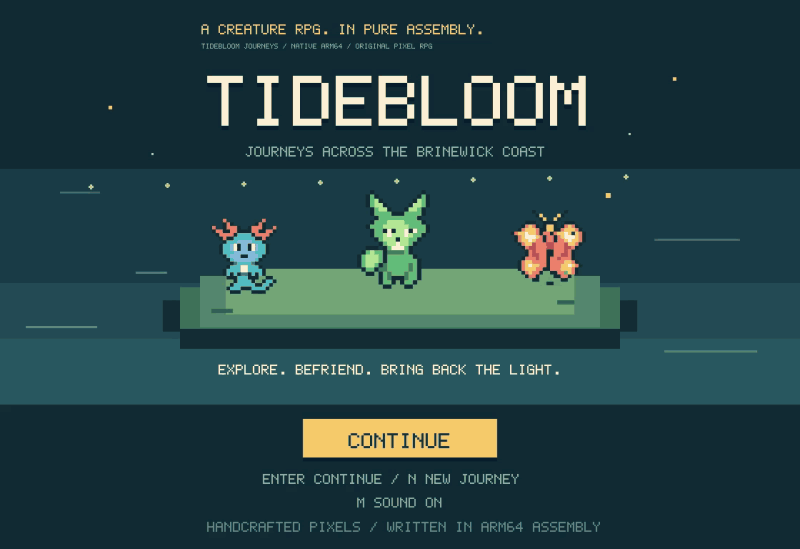

[**▶ Watch the 60-second demo with sound**](docs/media/demo.mp4)


</div>

---

## What is in the game

- **Six connected regions.** Explore Brinewick, Reedway, Emberport, Cinderpass, Moonfen and Crownreach. Each region has its own map, music and objective.
- **Six companion species.** Each species has a signature move. Sprig drains health, Cinder burns, Rill heals, Crag gains armor, Glim weakens and Zeph rewards timing.
- **Real evolution.** At level 8 each companion evolves into a new form with 18 more maximum health. The game has 13 creature forms in total.
- **Tactical battles.** You can see the enemy's next move before you act. Build energy, spend it on signature moves, or guard to block a heavy charge.
- **Trainers, towns and quests.** Fight six named trainers and restore three beacons. Then face Auralith, the ancient guardian of the coast.
- **Synthesized sound.** The assembly code makes all music and sound effects, sample by sample, in the audio callback.
- **Safe saves.** Saves are versioned and checksummed. The game writes each save to a temporary file and then renames it, so a failed save does not damage the old one.

## Screenshots

| Title | Battle |
|:---:|:---:|
| 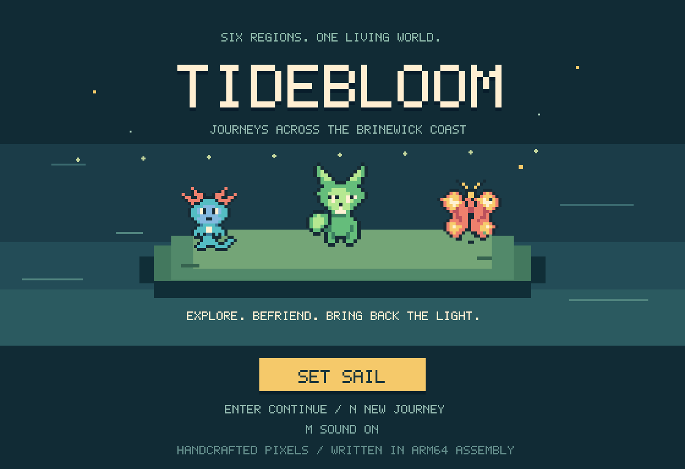 | 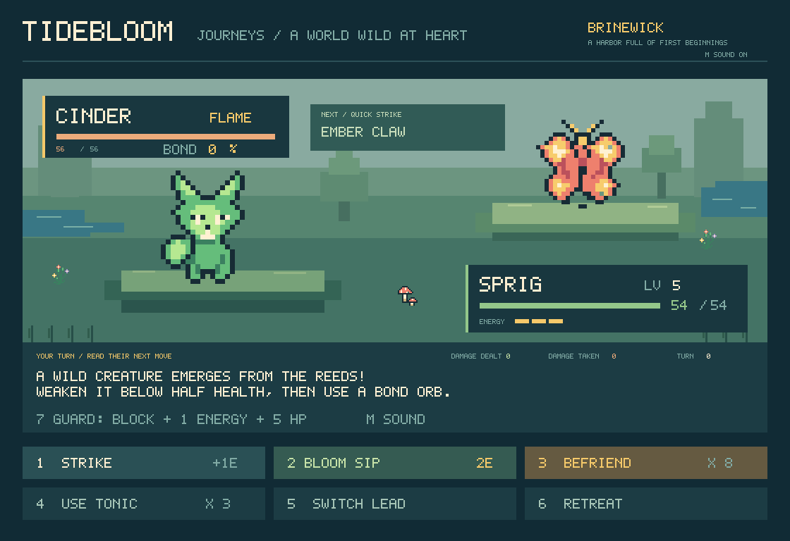 |
| **Evolution** | **Region map** |
| 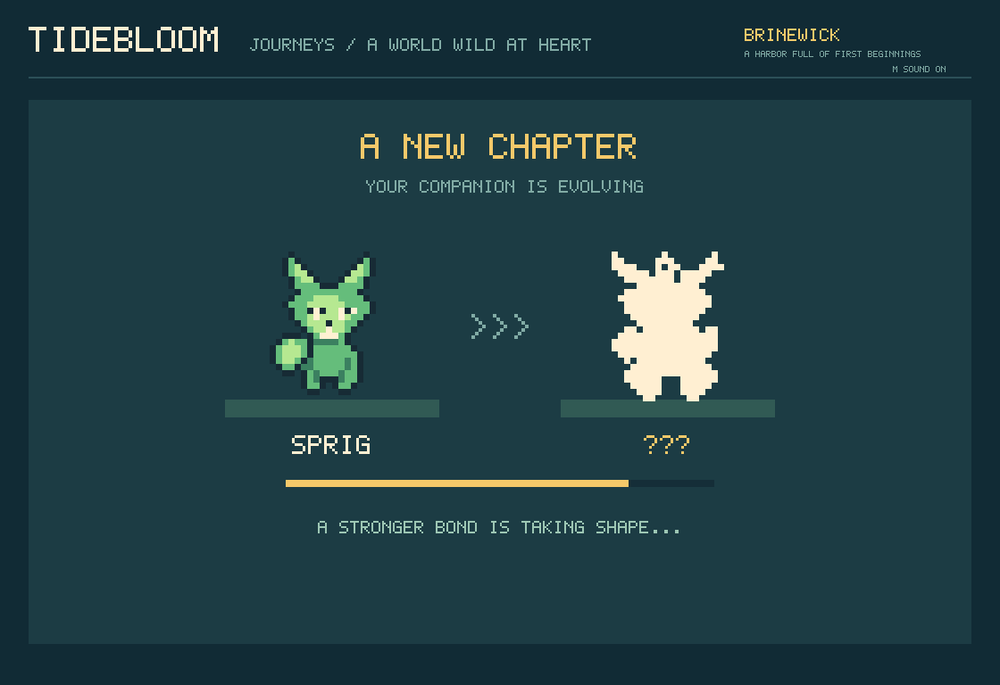 | 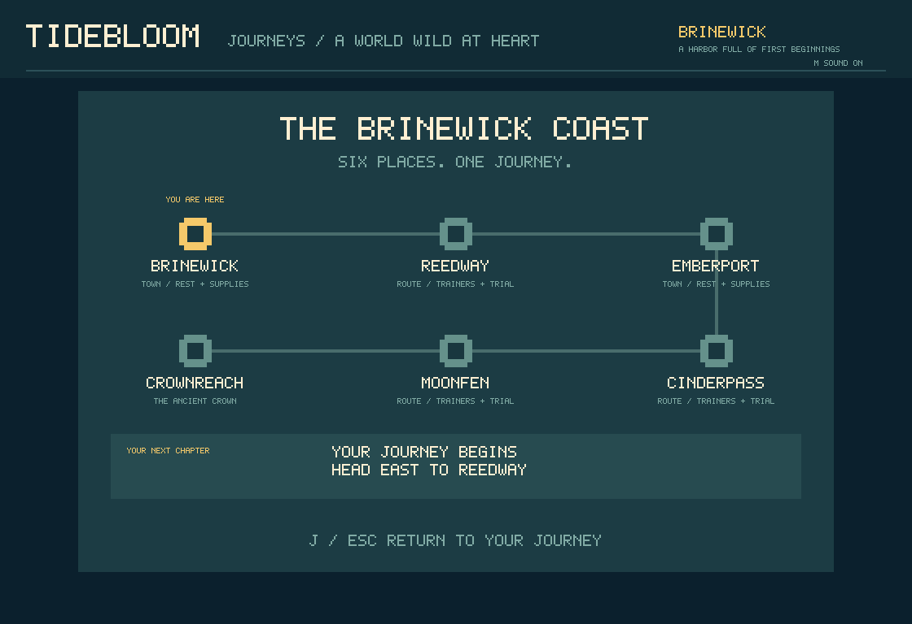 |

### The six regions

| Brinewick | Reedway | Emberport |
|:---:|:---:|:---:|
| 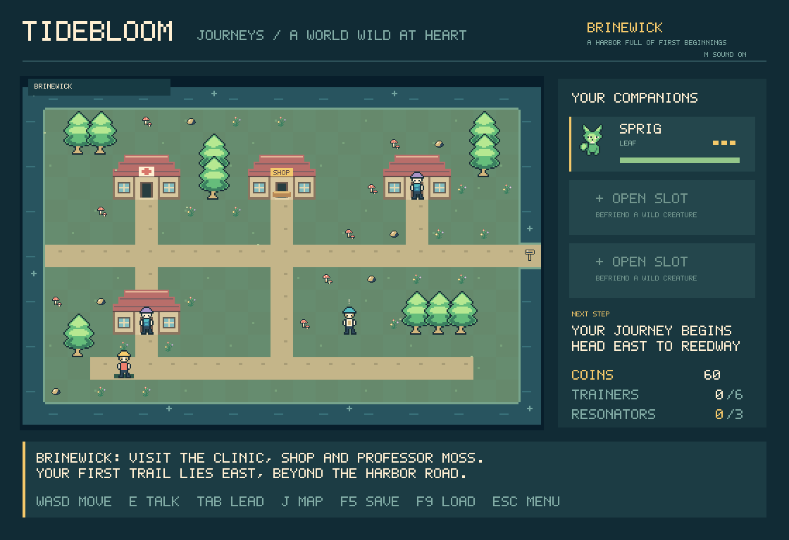 | 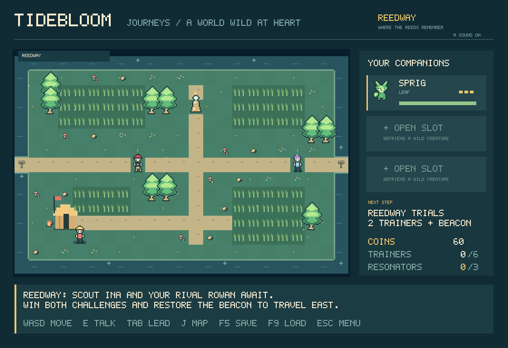 | 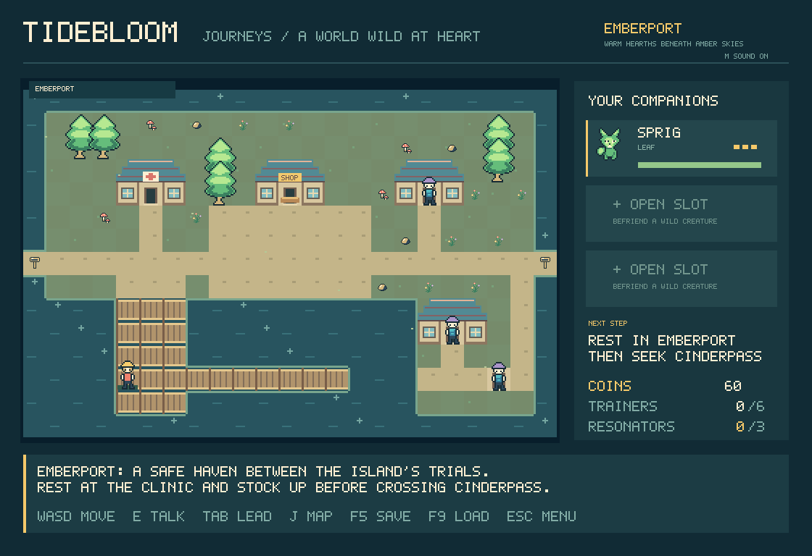 |
| **Cinderpass** | **Moonfen** | **Crownreach** |
| 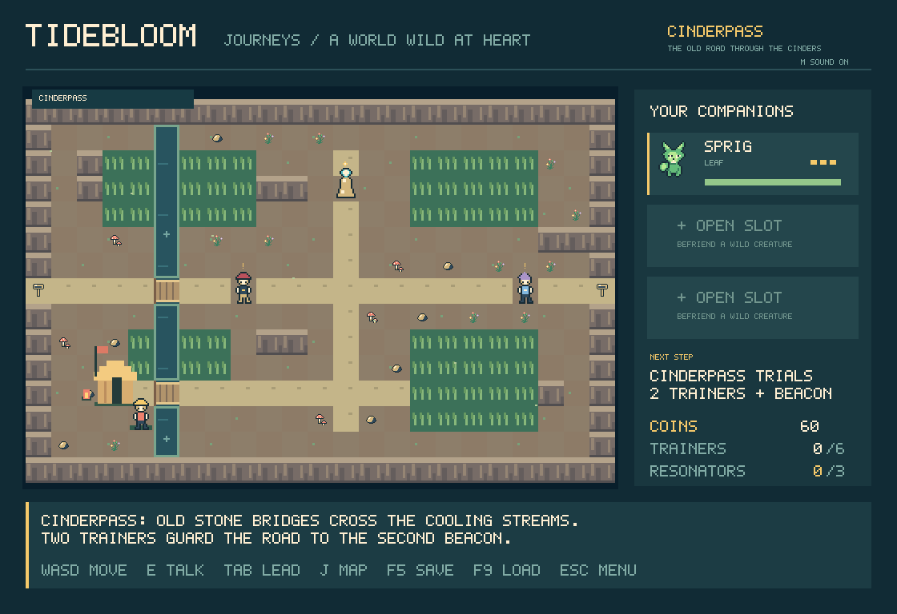 | 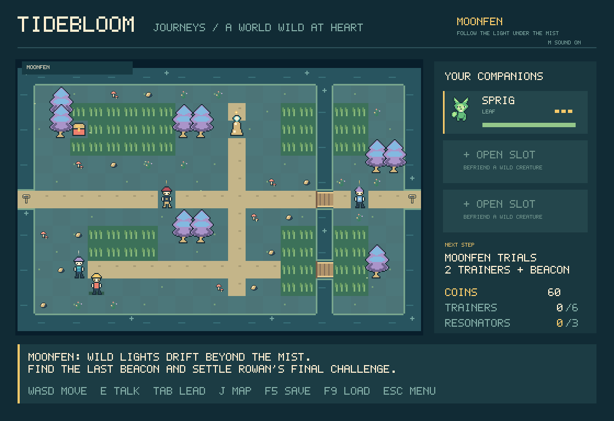 | 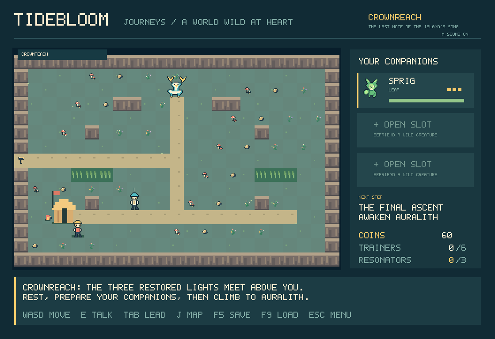 |

### Battle and evolution in motion

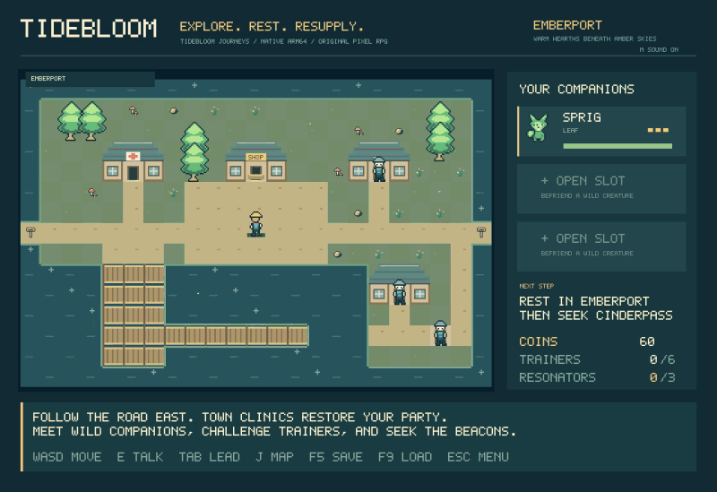

## Download and play

1. Download `Tidebloom-Journeys-macOS-arm64.zip` from the [latest release](https://github.com/ArneshBanerjee/tidebloom-asm/releases/latest).
2. Unzip the file. Move `Tidebloom-Journeys.app` to a folder you can write to, for example your Desktop. The game keeps its save file beside the app.
3. The app does not have an Apple Developer ID signature, so macOS blocks the first launch. To let it open, run this command in the folder that has the app:

```bash
xattr -dr com.apple.quarantine Tidebloom-Journeys.app
```

4. Open `Tidebloom-Journeys.app`.

You need an Apple Silicon Mac with macOS 27 or newer. The app includes the SDL libraries.

## Build from source

You need an Apple Silicon Mac, Apple's command-line tools and SDL2.

```bash
brew install sdl2
```

```bash
git clone https://github.com/ArneshBanerjee/tidebloom-asm.git
```

```bash
cd tidebloom-asm && ./build.sh
```

```bash
open Tidebloom-Journeys.app
```

`build.sh` assembles all source files with one `clang` command. Then it copies the SDL libraries into the app and signs the app locally. To use SDL from a different location, set `SDL2_PREFIX` or `SDL3_PREFIX`.

> [!NOTE]
> The build targets macOS 27 because the bundled SDL libraries need it. To target an older macOS, use SDL libraries that support it and change `-mmacosx-version-min` in `build.sh`.

## Controls

| Key | Action |
|---|---|
| WASD or arrow keys | Walk. Hold a direction to keep walking. |
| Enter or E | Talk, interact, confirm, or continue after a battle |
| Tab | Change your lead companion outside battle |
| J or H | Open or close the region map |
| F5 / F9 | Save / load (stand still, outside battle) |
| 1 | Strike: gain 1 energy |
| 2 | Signature move: spend 2 energy |
| 3 | Befriend a weakened wild creature |
| 4 | Use a tonic |
| 5 | Switch your lead in battle |
| 6 | Retreat from a wild encounter |
| 7 | Guard: gain energy, heal 5 HP, and make your next attack stronger |
| M | Mute or unmute |
| Esc | Pause at the title, or close the region map |
| N / Q | New journey / quit, from the title |

**Tips.** Read the enemy's NEXT move. Guard blocks three quarters of a heavy charge. Bring a wild creature down to half health or less before you use a bond orb. The battle panel shows the capture chance. You cannot catch or run from trainer teams.

## How it works

The game is plain AArch64 assembly for the Apple ABI. SDL2 gives the game a window, keyboard and mouse input, an audio device and a renderer. The game draws all pixels itself with filled rectangles.

| File | Lines | What it does |
|---|---:|---|
| [`src/game.s`](src/game.s) | 2,636 | Combat, party, experience, evolution, trainers, quests, save fields |
| [`src/render.s`](src/render.s) | 2,182 | Pixel renderer, bitmap text, HUD, towns, region map, evolution screen |
| [`src/assets.s`](src/assets.s) | 1,509 | Original pixel sprites, animation frames and the bitmap font, as data |
| [`src/anim.s`](src/anim.s) | 1,036 | Walking, battle timelines, evolution timing, transitions |
| [`src/main.s`](src/main.s) | 954 | Entry point, window, input, menus, test and capture modes |
| [`src/save.s`](src/save.s) | 750 | Validation, serialization, atomic save and load |
| [`src/recorder.s`](src/recorder.s) | 581 | Records the gameplay demo, frame by frame |
| [`src/effects.s`](src/effects.s) | 573 | Particles, projectiles, hit feedback |
| [`src/audio.s`](src/audio.s) | 500 | Music and sound-effect synthesizer |
| [`src/world.s`](src/world.s) | 349 | Six maps, exits, route gates, interactions |

Some details:

- **Game state** is a set of global symbols such as `_mode`, `_team_hp` and `_enemy_intent`. Small macros (`GET`, `PUT`, `ADDR`) wrap the `adrp` and `@PAGEOFF` addressing.
- **Randomness** comes from a small xorshift generator. The seed is part of the save, so a loaded save gives the same results again.
- **Saves** have a magic value, a version, a header and a hash. The game checks all fields before it changes any state.
- **Maps** are 23 by 15 tile grids, stored as bytes in `src/world.s`.

## Tests

The binary has built-in test modes. Each mode prints a result and exits with status 0 when it passes.

```bash
Tidebloom-Journeys.app/Contents/MacOS/tidebloom --self-test
```

```bash
Tidebloom-Journeys.app/Contents/MacOS/tidebloom --world-test
```

```bash
Tidebloom-Journeys.app/Contents/MacOS/tidebloom --animation-test
```

```bash
Tidebloom-Journeys.app/Contents/MacOS/tidebloom --audio-test
```

```bash
TIDEBLOOM_SAVE_PATH=/tmp/tidebloom-qa Tidebloom-Journeys.app/Contents/MacOS/tidebloom --save-test
```

The save test writes only to the path you give, with `.selftest` added to the end. `--save-path` shows the normal save location and does not write a file.

## Saves

Saves are manual. Press F5 before you quit. The game keeps `tidebloom-save.dat` beside the app. When the game starts, press Enter to continue a valid save. A new game does not replace your old save until you press F5. For development, `TIDEBLOOM_SAVE_PATH` changes the save location.

## Record the demo

The game can record its own showcase. It writes raw video frames and audio, and FFmpeg encodes them. To keep the raw video off the disk, send the frames through a FIFO:

```bash
mkdir rec && mkfifo rec/video.bgra
```

```bash
ffmpeg -f rawvideo -pix_fmt bgra -s 1120x768 -r 30 -i rec/video.bgra -c:v libx264 -pix_fmt yuv420p video.mp4 &
```

```bash
Tidebloom-Journeys.app/Contents/MacOS/tidebloom --record-demo rec
```

```bash
ffmpeg -i video.mp4 -f s16le -ar 22050 -ac 1 -i rec/audio.pcm -c:v copy -c:a aac demo.mp4
```

The demo starts each scene from a checkpoint. Battles, evolution, purchases and saves in each scene use the real game rules. The demo uses its own save file and does not touch your save.

## Credits

The game code, pixel art, animation and music are original. [SDL](https://www.libsdl.org/) provides the platform layer. Its licenses are in [`third-party/`](third-party/).
